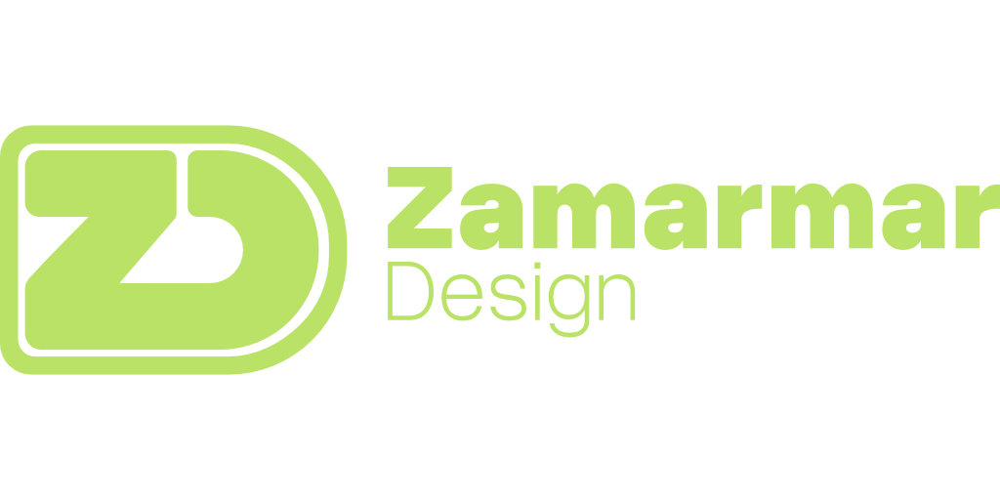

### Creative vision. Engineering precision.

**A premium creative and software development agency building exceptional digital products and experiences for clients worldwide.**

[Website](https://zamarmardesign.com) · [GitHub](https://github.com/Zamarmar-Tech)

---

## Where creativity meets technology

At **Zamarmar Design**, we combine imaginative design with rigorous engineering to create digital work that looks remarkable and performs with purpose.

We are a **hybrid creative and development agency**, bringing together high-end visual production, bespoke software development, immersive web experiences, and original digital products. From early concepts to production-ready solutions, our approach is thoughtful, collaborative, and detail-driven.

We work with a global outlook, partnering with organizations and ambitious teams seeking a distinctive creative and technical partner.

## What we do

| Creative & Visual Studio                                                     | Software & Digital Engineering                                                       |
|:---------------------------------------------------------------------------- |:------------------------------------------------------------------------------------ |
| **Branding & Graphic Design** - visual identities and polished design assets | **Custom Software Development** - purpose-built applications and platforms           |
| **Motion Graphics** - animated visual storytelling and digital content       | **Web Applications** - intuitive, scalable digital solutions                         |
| **3D Modeling & Rendering** - detailed 3D assets, scenes, and visualizations | **Product Development** - from prototypes to evolving software products              |
| **UI/UX Design** - expressive interfaces grounded in usability               | **Interactive & Cinematic Websites** - sophisticated, animation-rich web experiences |

## Products & explorations

Alongside our client services, we build and explore our own software products across different disciplines:

- **Immersive Web Experiences** - experiments at the intersection of graphics, interaction, and engineering.
- **Video Annotation** - tools for visual review and annotation workflows.
- **Digital Calligraphy (In Development)** - creative tooling for expressive lettering and calligraphic work.
- **QR Code Solutions (In Development)** - a suite of tools for QR-based digital interactions.
- **Visual Web Building (In Development)** - intuitive tools for creating web experiences visually.

> **A note on our repositories:** Much of our client work and product development happens in private repositories. Our public GitHub presence is a curated view of our engineering and creative interests, not a complete portfolio.

## How we approach every project

**Design with intent.** We prioritize clarity, character, and memorable visual communication.

**Engineer for longevity.** We value clean foundations, reliable performance, and maintainable solutions.

**Collaborate without borders.** We communicate clearly and work thoughtfully across teams and time zones.

**Craft every detail.** From the smallest interaction to the broadest product experience, execution matters.

## Let's create something exceptional

Looking for a partner for a distinctive brand experience, motion or 3D production, custom software platform, or ambitious digital product?

**Explore our work and get in touch:** [zamarmardesign.com](https://zamarmardesign.com)

---

Creative & Development Agency · Serving clients worldwide

